<picture>
  <source media="(prefers-color-scheme: dark)" srcset="assets/banner-dark.svg">
  
</picture>

Developer on GitHub since 2017. I build AI agents, realtime voice AI and ML systems, and I contribute fixes to the open-source AI tools I use every day. University of Toronto, Machine Learning.

<picture>
  <source media="(prefers-color-scheme: dark)" srcset="assets/stats-dark.svg">
  
</picture>

<!-- OSS-CONTRIBUTIONS:START -->
<!-- OSS-CONTRIBUTIONS:END -->

## Tech stack

<table>
<tr><td><b>Languages</b></td><td>       </td></tr>
<tr><td><b>LLMs and AI APIs</b></td><td>        </td></tr>
<tr><td><b>ML and inference</b></td><td>           </td></tr>
<tr><td><b>Local and on-device AI</b></td><td>       </td></tr>
<tr><td><b>Agents and tooling</b></td><td>          </td></tr>
<tr><td><b>RAG and search</b></td><td>    </td></tr>
<tr><td><b>Voice and telephony</b></td><td>          </td></tr>
<tr><td><b>Messaging and notifications</b></td><td>    </td></tr>
<tr><td><b>Web and frontend</b></td><td>        </td></tr>
<tr><td><b>Backend and data</b></td><td>             </td></tr>
<tr><td><b>Cloud and DevOps</b></td><td>      </td></tr>
<tr><td><b>Apple platforms</b></td><td>       </td></tr>
</table>

## My open-source projects

| Project | What it does |
|---|---|
| [**claude-managed-agents-skill**](https://github.com/0xArx/claude-managed-agents-skill) | Claude Code skill for building on the Claude Managed Agents API |
| [**hashling**](https://github.com/0xArx/hashling) | Free, open-source Mac security agent that explains findings in plain words. [gethashling.com](https://gethashling.com) |
| [**loopcoding-skill**](https://github.com/0xArx/loopcoding-skill) | Writes a self-verifying loop for a coding agent, grounded in your repo. [loopcoding.dev](https://loopcoding.dev) |
| [**jevegis**](https://github.com/0xArx/jevegis) | Guardrails for LLM apps in one API call: prompt injection, jailbreaks, leaks |
| [**vocalizer-mac**](https://github.com/0xArx/vocalizer-mac) | Removes music from any app system-wide and keeps the voices. [getvocalizer.com](https://getvocalizer.com) |
| [**Humanize**](https://github.com/0xArx/Humanize) | Gives an AI agent an inbox, phone, wallet, accounts and memory |
| [**voke-cli**](https://github.com/0xArx/voke-cli) | Send real voice alarms to an iPhone from the terminal, or let your agent do it |

## What I've built

Most of my work lives in private repos. Here is what it covers, grouped by area, with live links where there are any.

### AI agents and orchestration

| Project | What it does | Built with |
|---|---|---|
| **Enterprise AI command center** | One agent platform for a 100+ person company that acts across ERP, HR, email, finance and approvals. Role-checked, schema-validated tool calls; runs on-prem | Multi-agent orchestration, tool calling, RBAC, encrypted RAG |
| [**Groundwork**](https://groundwork-reports.vercel.app) | WhatsApp voice notes and site photos become construction reports, open-item registers and weekly summaries | Claude vision, Whisper, WhatsApp Cloud API, Neon |
| **Tender-to-quotation agent** | Reads tender drawings and requests, builds the bill of quantities, drafts RFQs and emails suppliers | LangGraph, LangChain, pgvector, multilingual-e5 |
| **Marketplace buying agents** | WhatsApp and Telegram agents that search, negotiate and buy on a classifieds marketplace through a real browser | Stagehand, Playwright, browser worker, pg_cron |
| [**Droplet.ai**](https://droplet.ai) | Agents put live widgets on your iPhone Home Screen and ask you questions you answer with one tap | SwiftUI, WidgetKit, remote MCP, Supabase Realtime |
| [**Humanize**](https://github.com/0xArx/Humanize) | Identity layer for agents: inbox, phone number, wallet, accounts and memory | Python, CLI, encrypted backup |
| [**loopcoding**](https://loopcoding.dev) | Designs self-verifying loops for coding agents instead of one-shot prompts | Claude Code skill |

### Realtime voice AI

| Project | What it does | Built with |
|---|---|---|
| **Awaaz** | Phone voice agents for a consular helpline pilot: answer calls 24/7, then hand off live to a human officer's browser phone | OpenAI Realtime over SIP, SignalWire, Twilio Voice SDK |
| **Voice agent platform** | Knowledge base to a live phone agent in under 3 minutes, with inbound support and outbound campaigns | OpenAI Realtime, VAPI, Twilio, RAG, HMAC-verified webhooks |
| **Voice tutor for kids** | Talks with children and drives 100+ on-screen visuals from a second, cheap model at about $0.0001 a turn | OpenAI Realtime over WebRTC, ElevenLabs, per-age VAD tuning |
| **Fully local phone agent** | The whole call path with no cloud: local LLM, speech-to-text, text-to-speech and the phone line on one machine | Ollama (gpt-oss), Speaches Whisper, Kokoro, Asterisk, Docker |
| [**Vocalizer**](https://getvocalizer.com) | Strips background music from any app, video or YouTube tab in real time and keeps the voices; Mac app and Chrome extension | Source separation on GPU, ONNX Runtime, Core Audio, Swift, Sparkle |
| **LiveDub** | Live dubbing of any iPhone app's audio into another language | Speech-to-speech translation, iOS audio capture |
| [**voke**](https://github.com/0xArx/voke-cli) | Voice-note alarms on iPhone that agents can set from the terminal | SwiftUI, AlarmKit, APNs |

### Inference, ML and computer vision

| Project | What it does | Built with |
|---|---|---|
| **Drone detection model** | Fine-tuned detection transformer: 93% precision, 85% recall, 0.90 mAP@50, exported for the edge | RF-DETR, PyTorch, ONNX, custom dataset |
| [**Iris**](https://iris-live-vision.vercel.app) | Live vision console: detect, track, measure speed, identify and report on any video feed, in the browser | Transformers.js, RF-DETR, Grounding DINO, SmolVLM |
| [**Multi-radar fusion**](https://radar-fusion-3lines.vercel.app) | Merges radars and EO cameras into one air picture, with an AI copilot that explains alerts | EKF, Mahalanobis gating, GNN association, ASTERIX |
| **On-prem GPU serving** | Joined office GPUs into one cluster; benchmarked open-weight models on accuracy, latency and memory before serving | Ollama, LM Studio, quantization, embeddings split |
| **Imprint** | Upload documents and get an instant LoRA fine-tune, then chat with the weights alone | LoRA, Qwen3-0.6B, PEFT |

### Local and on-device AI

| Project | What it does | Built with |
|---|---|---|
| [**Hashling**](https://gethashling.com) | Your own cybersecurity engineer on the Mac: local guard, plain-language findings, MCP server for agents | TypeScript, osquery, MCP, Swift |
| [**Wisp**](https://internets-wisp.vercel.app) | An AI agent that runs entirely in your browser tab, with voice and memory | WebLLM, Whisper (WebGPU), IndexedDB |
| [**AiCards**](https://cardfile-app.vercel.app) | Business card and QR scanner that reads cards on device, on the App Store and the web | Apple Vision, Apple Intelligence, Tesseract |
| **Recap** | Captures what you do on your phone, then lets you chat about it with on-device Apple Intelligence | Foundation Models, SwiftUI |
| **Sitr** | Covers people on screen system-wide on the Mac in real time | On-device segmentation, Swift |

### Retrieval, search and AI safety

| Project | What it does | Built with |
|---|---|---|
| [**OpenLib AI**](https://openlib-ai.vercel.app) | Search and talk to all your files: images, video, docs, email, Drive, with sources | Hybrid search (pgvector + full text, RRF), OCR, multi-model pipeline, MCP |
| [**Jevegis**](https://jevegis.vercel.app) | Guardrails API for LLM apps: prompt injection, jailbreaks, credential and PII leaks, unsafe content | Typed AI judgments, BYO-key encryption (AES-256-GCM) |
| [**QRAgents**](https://qragents.ai) | Any QR code or NFC tag opens a custom AI agent trained on a product's docs | RAG, pgvector, Next.js |
| [**LectureLens**](https://lecturelens.vercel.app) | Records lectures and analyses teaching, topic coverage and each student's participation | Whisper, LLM analysis, Neon |

### Web, full-stack and apps

| Project | What it does | Built with |
|---|---|---|
| [**Groundwork**](https://groundwork-reports.vercel.app) | Company workspaces, join codes, diaries with weather, open-item register and weekly PDF reports for construction teams | Next.js, Neon, Vercel Blob, Claude, WhatsApp |
| [**VITRA**](https://vitra-atlas.vercel.app) | 3D atlas of the human body showing where every vitamin and mineral acts | Three.js, BodyParts3D, WebGL |
| [**Festoon**](https://festoon-party.vercel.app) | Upload a photo of a room and see it decorated, in English and Arabic | Image generation, Next.js, full RTL |
| **Alumni platform** | University alumni portal with feed, chat and news, plus an iPhone, Android and web app on the same API | Next.js, Neon, Expo, TestFlight |
| **Timesheets and calendars** | Project timesheets with approvals and reports; a shared team calendar with per-person sharing | Next.js, Neon, Microsoft Entra ID, scrypt auth |
| [**Hashling site + app**](https://gethashling.com) | Signed, notarized Mac security app with a background agent, local dashboard and installer | TypeScript, launchd, signed .pkg, MCP |

<picture>
  <source media="(prefers-color-scheme: dark)" srcset="https://raw.githubusercontent.com/0xArx/0xArx/output/snake-dark.svg">
  
</picture>

[LinkedIn](https://www.linkedin.com/in/abdulrahmanshahzad) · [X @AbuIsadotai](https://x.com/AbuIsadotai) · stats refresh daily
