<picture>
  <source media="(prefers-color-scheme: dark)" srcset="assets/banner-dark.svg">
  
</picture>

Developer on GitHub since 2017. I build AI agents, realtime voice AI and ML systems, and I contribute fixes to the open-source AI tools I use every day. University of Toronto, Machine Learning.

<picture>
  <source media="(prefers-color-scheme: dark)" srcset="assets/stats-dark.svg">
  
</picture>

<!-- OSS-CONTRIBUTIONS:START -->
<!-- OSS-CONTRIBUTIONS:END -->

## Tech stack

<table>
<tr><td><b>Languages</b></td><td></td></tr>
<tr><td><b>AI &amp; ML</b></td><td>  

</td></tr>
<tr><td><b>Web &amp; backend</b></td><td></td></tr>
<tr><td><b>Data</b></td><td></td></tr>
<tr><td><b>Cloud &amp; DevOps</b></td><td></td></tr>
<tr><td><b>Voice</b></td><td>OpenAI Realtime · WebRTC · Twilio · SIP · ElevenLabs · Whisper</td></tr>
<tr><td><b>Apple</b></td><td>Swift · SwiftUI · on-device models · macOS and iOS apps</td></tr>
</table>

## My open-source projects

| Project | What it does |
|---|---|
| [**claude-managed-agents-skill**](https://github.com/0xArx/claude-managed-agents-skill) | Claude Code skill for building on the Claude Managed Agents API |
| [**hashling**](https://github.com/0xArx/hashling) | Free, open-source Mac security agent that explains findings in plain words. [gethashling.com](https://gethashling.com) |
| [**loopcoding-skill**](https://github.com/0xArx/loopcoding-skill) | Writes a self-verifying loop for a coding agent, grounded in your repo. [loopcoding.dev](https://loopcoding.dev) |
| [**jevegis**](https://github.com/0xArx/jevegis) | Guardrails for LLM apps in one API call: prompt injection, jailbreaks, leaks |
| [**vocalizer-mac**](https://github.com/0xArx/vocalizer-mac) | Removes music from any app system-wide and keeps the voices. [getvocalizer.com](https://getvocalizer.com) |
| [**Humanize**](https://github.com/0xArx/Humanize) | Gives an AI agent an inbox, phone, wallet, accounts and memory |
| [**voke-cli**](https://github.com/0xArx/voke-cli) | Send real voice alarms to an iPhone from the terminal, or let your agent do it |

## What I've built

Most of my work lives in private repos. Here is what it covers, grouped by area, with live links where there are any.

### AI agents and orchestration

| Project | What it does | Built with |
|---|---|---|
| **Enterprise AI command center** | One agent platform for a 100+ person company that acts across ERP, HR, email, finance and approvals. Role-checked, schema-validated tool calls; runs on-prem | Multi-agent orchestration, tool calling, RBAC, encrypted RAG |
| **Counterpart** | Every employee gets their own AI agent; agents send each other permissioned requests that people approve | Claude Opus + Haiku, MCP server, Composio, Postgres |
| [**Groundwork**](https://groundwork-reports.vercel.app) | WhatsApp voice notes and site photos become construction reports, open-item registers and weekly summaries | Claude vision, Whisper, WhatsApp Cloud API, Neon |
| **Tender-to-quotation agent** | Reads tender drawings and requests, builds the bill of quantities, drafts RFQs and emails suppliers | LangGraph, LangChain, pgvector, multilingual-e5 |
| **Marketplace buying agents** | WhatsApp and Telegram agents that search, negotiate and buy on a classifieds marketplace through a real browser | Stagehand, Playwright, browser worker, pg_cron |
| [**Droplet.ai**](https://droplet.ai) | Agents put live widgets on your iPhone Home Screen and ask you questions you answer with one tap | SwiftUI, WidgetKit, remote MCP, Supabase Realtime |
| [**Humanize**](https://github.com/0xArx/Humanize) | Identity layer for agents: inbox, phone number, wallet, accounts and memory | Python, CLI, encrypted backup |
| [**loopcoding**](https://loopcoding.dev) | Designs self-verifying loops for coding agents instead of one-shot prompts | Claude Code skill |

### Realtime voice AI

| Project | What it does | Built with |
|---|---|---|
| **Awaaz** | Phone voice agents for a consular helpline pilot: answer calls 24/7, then hand off live to a human officer's browser phone | OpenAI Realtime over SIP, SignalWire, Twilio Voice SDK |
| **Voice agent platform** | Knowledge base to a live phone agent in under 3 minutes, with inbound support and outbound campaigns | OpenAI Realtime, VAPI, Twilio, RAG, HMAC-verified webhooks |
| **Voice tutor for kids** | Talks with children and drives 100+ on-screen visuals from a second, cheap model at about $0.0001 a turn | OpenAI Realtime over WebRTC, ElevenLabs, per-age VAD tuning |
| [**Glimpse**](https://glimpse-lens.vercel.app) / [**Wowzy**](https://wowzy.vercel.app) | Point your camera at anything and talk to it live; Wowzy is the kids version | Vision LLMs, streaming voice, iOS app |
| [**voke**](https://github.com/0xArx/voke-cli) | Voice-note alarms on iPhone that agents can set from the terminal | SwiftUI, AlarmKit, APNs |

### Inference, ML and computer vision

| Project | What it does | Built with |
|---|---|---|
| **Drone detection model** | Fine-tuned detection transformer: 93% precision, 85% recall, 0.90 mAP@50, exported for the edge | RF-DETR, PyTorch, ONNX, custom dataset |
| [**Iris**](https://iris-live-vision.vercel.app) | Live vision console: detect, track, measure speed, identify and report on any video feed, in the browser | Transformers.js, RF-DETR, Grounding DINO, SmolVLM |
| [**Multi-radar fusion**](https://radar-fusion-3lines.vercel.app) | Merges radars and EO cameras into one air picture, with an AI copilot that explains alerts | EKF, Mahalanobis gating, GNN association, ASTERIX |
| **On-prem GPU serving** | Joined office GPUs into one cluster; benchmarked open-weight models on accuracy, latency and memory before serving | Ollama, LM Studio, quantization, embeddings split |
| **Imprint** | Upload documents and get an instant LoRA fine-tune, then chat with the weights alone | LoRA, Qwen3-0.6B, PEFT |
| [**Vocalizer**](https://getvocalizer.com) | Removes background music from any app or YouTube in real time and keeps the voices | Source separation, ONNX Runtime on GPU, Core Audio, Swift |
| **LiveDub** | Live dubbing of any iPhone app's audio into another language | Speech-to-speech, iOS audio capture |

### Local and on-device AI

| Project | What it does | Built with |
|---|---|---|
| [**Hashling**](https://gethashling.com) | Your own cybersecurity engineer on the Mac: local guard, plain-language findings, MCP server for agents | TypeScript, osquery, MCP, Swift |
| [**Wisp**](https://internets-wisp.vercel.app) | An AI agent that runs entirely in your browser tab, with voice and memory | WebLLM, Whisper (WebGPU), IndexedDB |
| [**AiCards**](https://cardfile-app.vercel.app) | Business card and QR scanner that reads cards on device, on the App Store and the web | Apple Vision, Apple Intelligence, Tesseract |
| **Recap** | Captures what you do on your phone, then lets you chat about it with on-device Apple Intelligence | Foundation Models, SwiftUI |
| **Sitr** | Covers people on screen system-wide on the Mac in real time | On-device segmentation, Swift |
| **Fully local voice stack** | The whole phone agent with no cloud: LLM, speech-to-text, text-to-speech and telephony on one box | Ollama (gpt-oss), Whisper, Kokoro, Asterisk, Docker |

### Retrieval, search and AI safety

| Project | What it does | Built with |
|---|---|---|
| [**OpenLib AI**](https://openlib-ai.vercel.app) | Search and talk to all your files: images, video, docs, email, Drive, with sources | Hybrid search (pgvector + full text, RRF), OCR, multi-model pipeline, MCP |
| [**Jevegis**](https://jevegis.vercel.app) | Guardrails API for LLM apps: prompt injection, jailbreaks, credential and PII leaks, unsafe content | Typed AI judgments, BYO-key encryption (AES-256-GCM) |
| [**QRAgents**](https://qragents.ai) | Any QR code or NFC tag opens a custom AI agent trained on a product's docs | RAG, pgvector, Next.js |
| [**LectureLens**](https://lecturelens.vercel.app) | Records lectures and analyses teaching, topic coverage and each student's participation | Whisper, LLM analysis, Neon |

<picture>
  <source media="(prefers-color-scheme: dark)" srcset="https://raw.githubusercontent.com/0xArx/0xArx/output/snake-dark.svg">
  
</picture>

[LinkedIn](https://www.linkedin.com/in/abdulrahmanshahzad) · [X @AbuIsadotai](https://x.com/AbuIsadotai) · stats refresh daily
